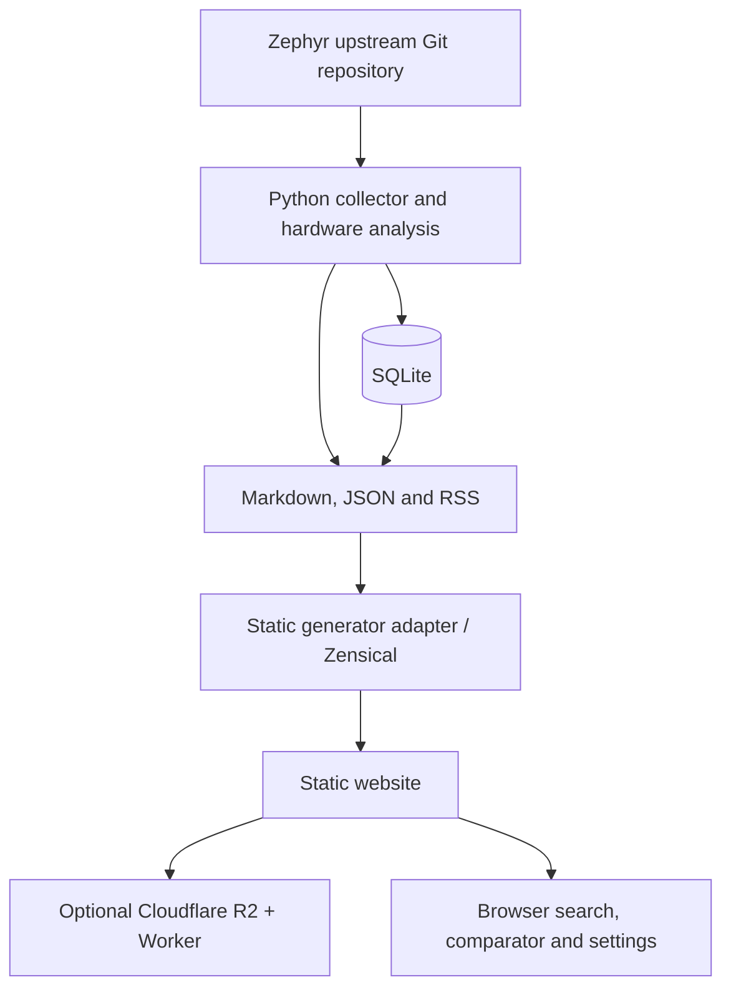

# Zephyr Pulse

**Hardware news and hardware selection intelligence for Zephyr RTOS.**

Zephyr Pulse is an independent, self-hosted tracker for the [Zephyr RTOS](https://github.com/zephyrproject-rtos/zephyr) project. It helps embedded systems engineers discover new hardware, follow upstream development and evaluate boards and microcontrollers for future product designs without manually reading Git logs.

## What it does

- **Hardware news:** Tracks new development boards, SoCs, sensors, drivers, devicetree changes, documentation and newly introduced board capabilities. News is displayed in compact, expandable tables with filters and direct links to upstream commits and source files.
- **Board explorer:** Provides board profiles, exact CPU targets, RAM and flash metadata, peripheral evidence and recent development milestones.
- **Hardware comparator:** Compares up to eight board targets against your product requirements using main, stable or configured LTS release snapshots.
- **Vendor intelligence:** Tracks hardware-related activity and contributor trends over the last 90 days.
- **Release and PR tracking:** Shows exact commit inclusion in release tags and recently updated hardware-related pull requests that may introduce future support.
- **Search and watchlists:** Supports case-insensitive substring and wildcard searches, such as `*mcxn*`, `ra8P1` and `*nrf54*`. Personal watchlists never restrict the global news feed.
- **Personal settings:** Saves watchlists, comparator selections, search preferences and display options in browser storage, with JSON import/export. No account is required.
- **RSS and JSON feeds:** Publishes machine-readable news and hardware intelligence for integration with other tools.

Hardware capability results are based on source evidence, including target YAML, board and SoC devicetree files, bindings and driver declarations. The analysis is heuristic: it does not compile Zephyr configurations or test physical hardware. Missing evidence does not mean a feature is unsupported, and a merged driver does not guarantee production readiness.

## How it works



The collector fetches upstream Git changes and release tags, analyzes first-parent commit history and stores recent events in SQLite. By default, detailed news covers a rolling **72-hour window**, while compact board milestones and vendor statistics cover **90 days**. Historical backfill runs in batches and its coverage is reported on the site.

Markdown, JSON and RSS are generated independently of the website renderer. Zensical builds the static HTML and provides native full-text search; Zephyr Pulse's structured hardware search and comparator use JSON and vanilla JavaScript. No application server or external search service is required. The supplied systemd timer runs every four hours.

## Installation

### Requirements

- Linux, Git and Python 3.11 or newer, with `venv` and `pip`.
- Sufficient disk space and network access for the complete upstream Git branch history and tags.
- Optional: AWS CLI v2 and a Cloudflare account for R2 publication; Node.js/npm for deploying the Cloudflare Worker.

No Zephyr SDK, `west`, GitHub token or paid API is required for basic operation. An optional GitHub token can increase rate limits for the open-PR snapshot.

### Run locally

Clone or download this repository, then from its root directory:

```bash
python3 -m venv .venv
source .venv/bin/activate
pip install -r requirements.txt

python pulse.py --no-publish
python -m http.server 8000 --bind 127.0.0.1 --directory site
```

Open <http://127.0.0.1:8000/>. The first run may take considerable time because it downloads the full Git history and analyzes hardware metadata. Subsequent runs reuse the local repository and fetch incremental changes. Console logging shows progress throughout collection and generation.

If you already have a complete, non-shallow local Zephyr repository, you can reuse it during the first synchronization:

```bash
python pulse.py --no-publish --git-seed /path/to/zephyr
```

### Configuration and operation

Server configuration is in `config.yml`. The main settings are:

| Setting | Default | Purpose |
| --- | --- | --- |
| `branch` | `main` | Upstream branch |
| `window_hours` | `72` | Detailed news retention |
| `history_days` | `90` | Historical intelligence retention |
| `history_batch` | `250` | Older commits processed per run |
| `site_url` | `http://localhost:8000/` | Website base URL |
| `publish` | `false` | Enable Cloudflare R2 publishing |
| `generator.native_search` | `true` | Enable Zensical full-text search |

Personal preferences are edited in the website's **Settings** page and override the published defaults. They do not change server configuration or the unfiltered news feed. Release lifecycle and LTS policy settings must be maintained against the [official Zephyr release policy](https://docs.zephyrproject.org/latest/releases/index.html).

Useful commands (run inside the virtual environment):

```bash
# Collect data and rebuild locally
python pulse.py --no-publish

# Show detailed diagnostics
python pulse.py --no-publish --verbose

# Complete the historical backfill in one run
python pulse.py --history-backfill --no-publish

# Collect and export data without building the website
python pulse.py --no-build --no-publish
```

For data-only installations, use `pip install -r requirements-core.txt` instead of `requirements.txt`.

By default, runtime data lives in `state/`, generated Markdown and feeds in `docs/`, and the rendered website in `site/`. Public feeds include `feed.xml`, `watchlist.xml` (server-configured watchlist), `events.json` and `intelligence.json`.

### Schedule automatic updates

The supplied systemd service expects the application at `/opt/zephyr-pulse`. On Debian/Ubuntu, after placing the project there, create a dedicated service user (if it does not already exist) and install the units:

```bash
sudo useradd --system --home-dir /opt/zephyr-pulse \
    --shell /usr/sbin/nologin zephyr-pulse
sudo chown -R zephyr-pulse:zephyr-pulse /opt/zephyr-pulse
cd /opt/zephyr-pulse
sudo -u zephyr-pulse python3 -m venv .venv
sudo -u zephyr-pulse .venv/bin/pip install -r requirements.txt
sudo install -m 0644 deploy/zephyr-pulse.service \
    deploy/zephyr-pulse.timer /etc/systemd/system/
sudo systemctl daemon-reload
sudo systemctl enable --now zephyr-pulse.timer
sudo systemctl start zephyr-pulse.service
```

The timer runs every four hours in UTC. To monitor collection:

```bash
journalctl -u zephyr-pulse.service -f
systemctl list-timers zephyr-pulse.timer
```

### Publish to Cloudflare R2 (optional)

The generated `site/` directory can be served by a static web server or published through the included Cloudflare R2 integration.

1. Create a private R2 bucket and scoped S3-compatible read/write credentials. Install AWS CLI v2 on the collector server.
2. Copy `deploy/env.example` to `/etc/zephyr-pulse.env`, populate the R2 account, bucket and access credentials, and restrict file permissions to root (`sudo chmod 600 /etc/zephyr-pulse.env`). The supplied systemd service loads this file. Never commit credentials.
3. Set `publish: true` and `site_url` to your public website URL in `config.yml`.
4. From `deploy/`, copy `wrangler.example.toml` to `wrangler.toml`, set `bucket_name` to match your R2 bucket, and deploy the Worker:

   ```bash
   npx wrangler login
   npx wrangler deploy
   ```

5. Attach a custom domain to the Worker and run `sudo systemctl start zephyr-pulse.service` to build and publish the site using the configured service environment.

The publisher uploads each build to a new release prefix and switches the active pointer only after upload succeeds. Retain the active release and recent rollback versions when pruning old R2 objects. A failed build or upload does not activate a new release.

See the [Cloudflare R2 documentation](https://developers.cloudflare.com/r2/) for account and bucket setup.

## License

Zephyr Pulse is released under the [MIT License](LICENSE). Upstream Zephyr, third-party dependencies and assets retain their respective licenses.

Zephyr Pulse is an unofficial, independent project and is not affiliated with or endorsed by the Zephyr Project.
