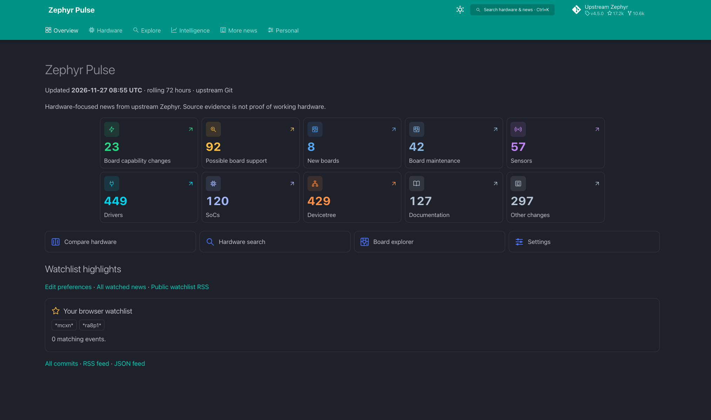
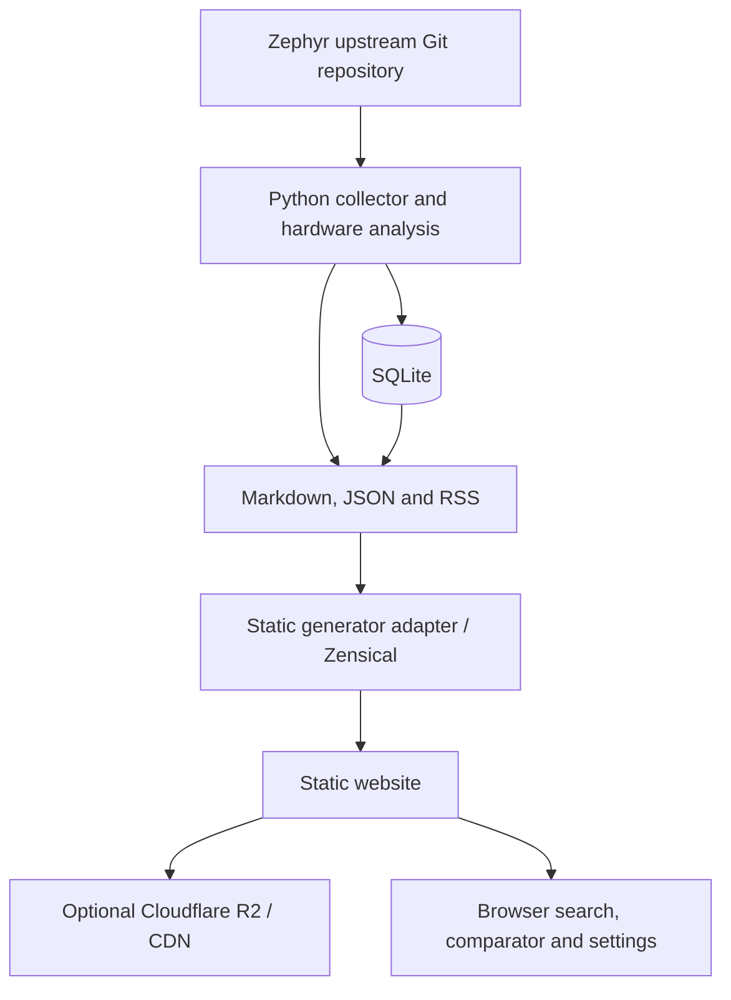

# Zephyr Pulse

**Hardware news and hardware selection intelligence for Zephyr RTOS.**

Zephyr Pulse is an independent, self-hosted tracker for the [Zephyr RTOS](https://github.com/zephyrproject-rtos/zephyr) project. It helps embedded systems engineers discover new hardware, follow upstream development and evaluate boards and microcontrollers for future product designs without manually reading Git logs.

## What it does

- **Hardware news:** Tracks new development boards, SoCs, sensors, drivers, devicetree changes, documentation and newly introduced board capabilities. News is displayed in compact, expandable tables with filters and direct links to upstream commits and source files.
- **Board explorer:** Provides board profiles, exact CPU targets, RAM and flash metadata, peripheral evidence and recent development milestones.
- **Hardware comparator:** Compares up to eight board targets against your product requirements using main, stable or configured LTS release snapshots.
- **Vendor intelligence:** Tracks hardware-related activity and contributor trends over the last 90 days.
- **Release and PR tracking:** Shows exact commit inclusion in release tags and recently updated hardware-related pull requests that may introduce future support.
- **Search and watchlists:** Supports case-insensitive substring and wildcard searches, such as `*mcxn*`, `ra8P1` and `*nrf54*`. Personal watchlists never restrict the global news feed.
- **Personal settings:** Saves watchlists, comparator selections, search preferences and display options in browser storage, with JSON import/export. No account is required.
- **RSS and JSON feeds:** Publishes machine-readable news and hardware intelligence for integration with other tools.

Hardware capability results are based on source evidence, including target YAML, board and SoC devicetree files, bindings and driver declarations. The analysis is heuristic: it does not compile Zephyr configurations or test physical hardware. Missing evidence does not mean a feature is unsupported, and a merged driver does not guarantee production readiness.

## How it works



The collector fetches upstream Git changes and release tags, analyzes first-parent commit history and stores recent events in SQLite. By default, detailed news covers a rolling **72-hour window**, while compact board milestones and vendor statistics cover **90 days**. Historical backfill runs in batches and its coverage is reported on the site.

Markdown, JSON and RSS are generated independently of the website renderer. Zensical builds the static HTML and provides native full-text search; Zephyr Pulse's structured hardware search and comparator use JSON and vanilla JavaScript. No application server or external search service is required. Schedule the collector every four hours using cron or the supplied systemd timer.

## Installation

### Requirements

- Linux, Git and Python 3.11 or newer, with `venv` and `pip`.
- Sufficient disk space and network access for the complete upstream Git branch history and tags.
- Optional: rclone and a Cloudflare account for direct R2 publication. The alternative bundled versioned Worker publisher uses AWS CLI v2 and Wrangler.

No Zephyr SDK, `west`, GitHub token or paid API is required for basic operation. An optional GitHub token can increase rate limits for the open-PR snapshot.

### Run locally

Clone or download this repository, then from its root directory:

```bash
python3 -m venv .venv
source .venv/bin/activate
pip install -r requirements.txt

python pulse.py --no-publish
python -m http.server 8000 --bind 127.0.0.1 --directory site
```

Open <http://127.0.0.1:8000/>. The first run may take considerable time because it downloads the full Git history and analyzes hardware metadata. Subsequent runs reuse the local repository and fetch incremental changes. Console logging shows progress throughout collection and generation.

If you already have a complete, non-shallow local Zephyr repository, you can reuse it during the first synchronization:

```bash
python pulse.py --no-publish --git-seed /path/to/zephyr
```

### Configuration and operation

Public server defaults are in `config.yml`. A private `config.local.yml`, if present, is automatically merged over them; `--config PATH` selects a different override. Mappings merge recursively, while lists and scalars replace defaults. Never commit your private configuration or credentials. The main settings are:

| Setting | Default | Purpose |
| --- | --- | --- |
| `branch` | `main` | Upstream branch |
| `window_hours` | `72` | Detailed news retention |
| `history_days` | `90` | Historical intelligence retention |
| `history_batch` | `250` | Older commits processed per run |
| `site_url` | `http://localhost:8000/` | Website base URL |
| `publish` | `false` | Enable the alternative bundled versioned publisher; leave false for direct rclone sync |
| `generator.native_search` | `false` | Optional Zensical full-text search; structured header search is always available |
| `generator.incremental` | `false` | Optional persistent renderer cache; validate on your installation before enabling |

Personal preferences are edited in the website's **Settings** page and override the published defaults. They do not change server configuration or the unfiltered news feed. Release lifecycle and LTS policy settings must be maintained against the [official Zephyr release policy](https://docs.zephyrproject.org/latest/releases/index.html).

Useful commands (run inside the virtual environment):

```bash
# Collect data and rebuild locally
python pulse.py --no-publish

# Show detailed diagnostics
python pulse.py --no-publish --verbose

# Complete the historical backfill in one run
python pulse.py --history-backfill --no-publish

# Collect and export data without building the website
python pulse.py --no-build --no-publish
```

For data-only installations, use `pip install -r requirements-core.txt` instead of `requirements.txt`.

Hardware evidence and stable/LTS snapshots are cached in SQLite. Board profiles retain their evidence revision until relevant sources change, while news and historical retention are refreshed on every run. The renderer reports actual byte-level file differences. Optional incremental rendering uses a separate persistent workspace and falls back to a clean staged build if validation fails.

By default, runtime data lives in `state/`, generated Markdown and feeds in `docs/`, and the rendered website in `site/`. Public feeds include `feed.xml`, `watchlist.xml` (server-configured watchlist), `events.json` and the compact `intelligence.json` catalog (schema version 3). The browser joins stable metadata with `data/activity.json` and `data/news-view.json`. It loads small news/preferences views from `data/` and retrieves detailed board evidence on demand via each target’s `evidence_url`. The generated `docs/data/` directory must not be committed.

### Schedule automatic updates

Run as the project owner. Use an absolute Python path and a lock to avoid overlapping scheduled jobs. For example, for a local-only installation at `/opt/zephyr-pulse`, add this to the owner's crontab:

```cron
0 */4 * * * flock -n /opt/zephyr-pulse/.cron.lock sh -c 'cd /opt/zephyr-pulse && .venv/bin/python pulse.py --no-publish' >> /opt/zephyr-pulse/pulse.log 2>&1
```

Alternatively, adapt the supplied `deploy/zephyr-pulse.service` and `.timer` to your installation. Use only one scheduler.

### Publish to Cloudflare R2 (optional)

The generated `site/` directory can be served by any static web server or synchronized directly to an R2 bucket. No Worker or AWS account is required for direct publishing.

1. Create a dedicated R2 Standard bucket, attach the public custom domain under the bucket settings, and create scoped object read/write credentials.
2. Install [rclone](https://rclone.org/), use `rclone config` to configure an S3 remote with the Cloudflare provider and account-specific R2 endpoint. Store credentials outside the Git repository with restricted permissions.
3. Set `site_url` to the public website URL and `publish: false` in the ignored `config.local.yml`. Generate the site with `python pulse.py --no-publish`.
4. Configure a Cloudflare URL Rewrite Rule for the public hostname to rewrite `/` to `/index.html`; other pages use explicit `.html` paths. Configure a Cache Rule for the hostname to cache static objects, including HTML and JSON, while respecting the origin TTL.
5. Test the dedicated bucket with `--dry-run`, then remove that option to publish:

   ```bash
   rclone sync site/ pulse_r2:YOUR_DEDICATED_BUCKET \
       --fast-list --checksum --delete-after --s3-no-check-bucket \
       --header-upload 'Cache-Control: public, max-age=300' \
       --stats 15s --stats-log-level INFO --log-level INFO --dry-run
   ```

   The remote name `pulse_r2` is an example. Sync deletes obsolete remote objects, so do not use a shared bucket. Schedule build and sync together in a private script that stops on failed builds and prevents concurrent publication. Identical objects are skipped where checksums are available. Direct sync is not an atomic deployment, and Cloudflare storage and operation charges may apply.

The bundled `deploy/publish.sh` and `deploy/worker.js` remain an alternative versioned publishing mechanism for operators who require an active-release pointer. Do not mix it with direct synchronization in the same bucket.

See the [Cloudflare R2 documentation](https://developers.cloudflare.com/r2/) and [rclone S3 documentation](https://rclone.org/s3/) for setup details.

## License

Zephyr Pulse is released under the [MIT License](LICENSE). Upstream Zephyr, third-party dependencies and assets retain their respective licenses.

Zephyr Pulse is an unofficial, independent project and is not affiliated with or endorsed by the Zephyr Project.

